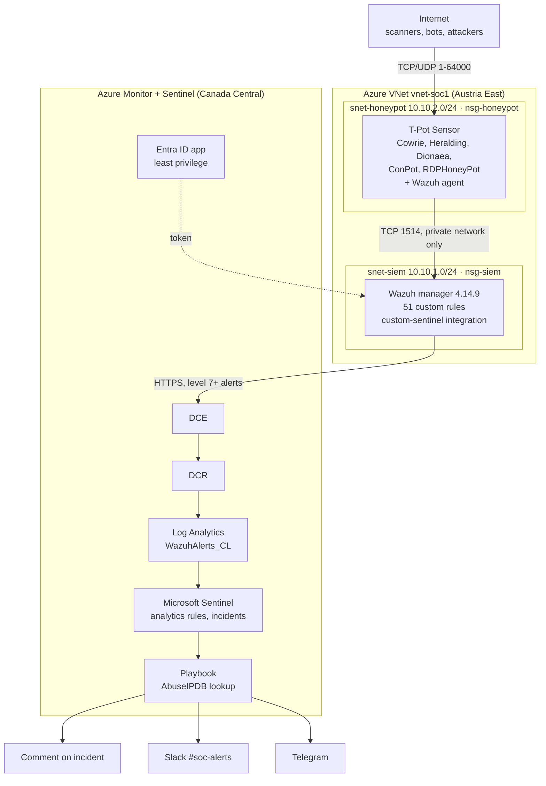

# Stage 3: Cloud SIEM and SOAR with Microsoft Sentinel

[Project overview](../README.md) · [Stage 1](../stage1-honeypot-elk/README.md) · [Stage 2](../stage2-wazuh-detection/README.md)

**Azure · Microsoft Sentinel · KQL · Logic Apps · Wazuh 4.14 · T-Pot · Python**

This is the third stage of my honeypot project. In [Stage 1](../stage1-honeypot-elk/README.md) I put T-Pot on the internet and watched about 18.8 million attack events pour into ELK. In [Stage 2](../stage2-wazuh-detection/README.md) I wrote 51 Wazuh detection rules so the data actually meant something.

By then Wazuh was catching attacks well, but it still felt like half a SOC. Nothing opened a ticket, nothing looked up the attacker for me, and nothing told me anything was happening unless I was staring at a dashboard. So for Stage 3 I moved the lab to Microsoft Azure, sent the serious alerts into Microsoft Sentinel, wrote analytics rules in KQL, and built a playbook that investigates each attacker and pings my phone.

## Summary

| Area | Result |
|---|---|
| Infrastructure | Segmented Azure VNet: honeypot and SIEM in separate subnets, each behind its own NSG |
| Ingestion | Custom Python integration from Wazuh to Sentinel through the Azure Monitor Logs Ingestion API |
| Detection | Two scheduled analytics rules in KQL: attacker access/malware delivery, and cross-honeypot reconnaissance |
| Response | Logic Apps playbook: AbuseIPDB enrichment, incident comment, Slack and Telegram alerts |
| Visibility | Sentinel workbook covering volume by honeypot, top attackers, severity and ATT&CK techniques |
| Tuning | One correlation rule reduced by ~98% (about 2,200 to 35 alerts per 6 hours) with no loss of coverage |
| Identity | Least-privilege Entra ID app for ingestion, managed identity for the playbook, all secrets out of source control |


## Architecture


<details>
<summary>Text version of the diagram (Mermaid)</summary>



</details>

**Why it's built this way**

- **I assume the honeypot gets compromised.** It's a machine I'm inviting attackers onto, so it can only reach the Wazuh manager on the two agent ports (1514/1515). Everything else from inside the network is blocked.
- **Two regions, by accident more than design.** I wanted everything in Canada Central, but my Free Trial couldn't get the B-series VM sizes there, so the VMs went to Austria East. Later I found out Sentinel doesn't run in Austria East at all, so the monitoring side ended up back in Canada Central. The integration talks over HTTPS, so the split doesn't matter in practice.
- **Only what I needed.** T-Pot runs as a Sensor (honeypots only, 8 GB) and Wazuh runs as a bare manager (4 GB). Sentinel replaced ELK, the Wazuh indexer and the dashboard.
- **Only the alerts worth reading.** On Vultr, Wazuh produced about 124,000 alerts in 15 hours. Most were "someone connected" at level 3 to 5. Those stay in Wazuh, and only level 7 and up goes to Sentinel.


## Network controls

**nsg-siem** (Wazuh manager)

| Priority | Rule | Allows | Purpose |
|---|---|---|---|
| 100 | Allow-SSH-MyIP | TCP 22 from the administrator IP | Management access |
| 110 | Allow-Wazuh-Agents-VNet | TCP 1514-1515 from the VNet | Agent events and enrolment |
| 4000 | Deny-VNet-Other | Deny all other VNet traffic | Contain a compromised honeypot |

**nsg-honeypot** (T-Pot)

| Priority | Rule | Allows | Purpose |
|---|---|---|---|
| 100 | Allow-My-Mgmt-IP | All ports from the administrator IP | Management, including SSH on 64295 (T-Pot moves SSH there so Cowrie can own port 22) |
| 110 | Deny-Vnet-Other | Deny all traffic from the VNet | Keep internal traffic out of attack data |
| 200 | Opening-VM-to-internet | Ports 1-64000 from any source | Exposed honeypot services; administrative ports stay above this range |

I only opened the honeypot to the internet once the Wazuh agent was running. There was no point letting attackers in before anything was recording them.


## Log ingestion pipeline

Sentinel doesn't take logs directly. They land in a Log Analytics workspace and Sentinel reads from there. Wazuh has no built-in way to write to it, so I wrote one in Python.

`integrations/custom-sentinel.py` runs on the Wazuh manager for every alert at level 7 or above. It:

1. Normalises the nested Wazuh alert into a flat 24-column schema (`RuleId`, `RuleLevel`, `SrcIp`, `Username`, `Command`, `Url`, `FileHash`, `MitreIds`, `Honeypot` and others) and drops empty fields.
2. Authenticates to Entra ID with the client credentials flow and caches the token until shortly before expiry.
3. Submits the record to the Data Collection Endpoint. The Data Collection Rule validates the schema and routes it to the custom table `WazuhAlerts_CL`.

| Component | Configuration |
|---|---|
| Runtime | Python standard library only, executed by Wazuh's bundled interpreter |
| Identity | Entra ID app `wazuh-sentinel-ingest`, Monitoring Metrics Publisher on the DCR only |
| Secrets | `sentinel.json` on the manager (root:wazuh, 640); only `sentinel.json.example` is published |
| TLS | Certificate verification enforced against the OS CA bundle |
| Failure handling | Token refresh and single retry on 401/403; all errors logged to `integrations.log` without interrupting Wazuh |


## Detection engineering

The Stage 2 rules carried over, and within a day all five honeypots were producing alerts. The first screenshot is every rule hit in Wazuh, at any level. The second is what made it through to Sentinel after the level 7 filter.


### Rule 1: Attacker access or malware delivery
Severity High · runs every 5 minutes · ATT&CK Initial Access, Execution, Command and Control

```kusto
WazuhAlerts_CL
| where RuleLevel >= 12
| project TimeGenerated, RuleId, RuleDescription, Honeypot, SrcIp, Username, Command, Url, FileHash, MitreIds
```

Level 12 and up means someone logged in, ran something dangerous, or downloaded a file. On a real server, any of those is a compromise. IP, URL and file hash are mapped as entities, and alerts with the same entities within 5 hours become one incident, so a bot that logs in and runs ten commands is one ticket, not eleven.

### Rule 2: Same attacker across multiple honeypots
Severity Medium · runs hourly · ATT&CK Reconnaissance (T1595), Discovery (T1046)

```kusto
WazuhAlerts_CL
| where isnotempty(SrcIp) and Honeypot != "other"
| summarize HoneypotCount = dcount(Honeypot), Honeypots = make_set(Honeypot),
            Alerts = count(), Rules = make_set(RuleId),
            FirstSeen = min(TimeGenerated), LastSeen = max(TimeGenerated) by SrcIp
| where HoneypotCount >= 2
```

This is the one I'm proudest of, because no single honeypot can see it. An IP hammering VNC is background noise. An IP that tries SSH, then SMB, then a fake industrial controller is scanning the whole network for a way in. Four days after I wrote it, it fired on a real attacker, `45.156.87[.]70`.


## Response automation

The first thing any analyst does with a new incident is look up the attacker's IP. I wanted that done before I even opened it. When either analytics rule creates an incident, an automation rule runs the playbook `pb-abuseipdb-enrich` (a Logic App):

| Step | Action |
|---|---|
| 1 | Extract IP entities from the incident |
| 2 | Query AbuseIPDB for each IP: confidence score, reports (90 days), country, ISP, usage type, Tor exit status |
| 3 | Add the results to the incident as a comment |
| 4 | Send an alert with severity, attacker IP, reputation score and incident link to Telegram and to Slack `#soc-alerts` |

**Security controls.** The playbook authenticates with a system-assigned managed identity holding Microsoft Sentinel Responder on the workspace. HTTP actions use secure inputs and outputs, so the API key, bot token and webhook URL are excluded from run history.

**The first real catch.** On the evening I finished the playbook, incident 52 came in: a successful Cowrie login from `195.178.110[.]78`. By the time I clicked on it, the comment was already there. AbuseIPDB score 100 out of 100, 1,995 reports in 90 days, a data-centre hosting provider in the Netherlands. A rented server that thousands of people had already reported, and I hadn't lifted a finger.


A week later I added Telegram and Slack. Now a new incident buzzes my phone within seconds, which was useful right up until the bots kept it buzzing all night and I had to mute the chat.

| Telegram (lock screen) | Telegram (chat) |
|---|---|
|  |  |


## Monitoring

The workbook `Honeypot SOC Overview` has four views: alerts over time by honeypot, the top 10 attackers and which honeypots they touched, alerts by severity, and the most common ATT&CK techniques. The template is in `sentinel/`.

It was also interesting to watch it change. The one at the top of this page is from 15 November, when Cowrie got most of the attention. By 23 November, Dionaea had taken over on volume and brute force (T1110) was the top technique.


## Alert tuning

The dashboard was the first thing that told me something was wrong, which is really the point of having one.

The first problem was Heralding's VNC rule. It was 89% of everything Sentinel received. I moved it below the forwarding threshold, and almost immediately a second problem showed up: the correlation rule that was meant to replace it started firing nonstop, because bots that never give up kept re-triggering it.

| Rule | Issue | Change | Outcome |
|---|---|---|---|
| 100021 Heralding VNC session (level 8) | 89% of forwarded alerts (975 of 1,092 in a 25-minute sample); single sessions carry little value | Lowered below the forwarding threshold; still recorded in Wazuh | Repeat offenders remain covered by correlation rule 100029 |
| 100029 Heralding repeated sessions (level 10) | Persistent sources re-triggered it continuously, 1,300 to 1,700 alerts per top IP | Added `ignore="600"` (10-minute suppression per firing) | ~98% reduction, every attacking IP still reported |

| 6-hour window | Rule 100029 alerts |
|---|---|
| 11 Nov, before change | 2,034 · 2,182 · 2,333 · 2,309 |
| 12 Nov, after change | 36 · 35 |

About 98% fewer alerts, and every attacking IP still gets reported, just once every 10 minutes instead of constantly.


## What broke and what I learned

Most of my time on this stage went into fixing things, not building them. These are the ones worth remembering.

| What broke | Why | Fix | What I learned |
|---|---|---|---|
| The T-Pot installer refused to run | The current release requires Ubuntu 26.04; the VM was built on 24.04 | Rebuilt the VM on 26.04 | Read the vendor's requirements before choosing an image, not after |
| A Hive install left 416 MB of free RAM | Hive runs its own Elasticsearch, which needs about 16 GB | Reinstalled T-Pot as a Sensor | Size to the vendor's minimums and measure memory right after install |
| No honeypot containers started | `tpotinit` failed validation: `TPOT_TYPE` was still `HIVE`, then `TPOT_HIVE_USER` was empty | Set `TPOT_TYPE=SENSOR` and gave the Hive fields placeholder values | Running the failing component alone (`docker compose up tpotinit`) surfaces the real error; reinstalling only reproduced it |
| Three Windows rules were ignored at load | Custom and built-in rule files load as one alphabetical list, and `06_windows_bait_rules.xml` sorts before the files holding parents 92653 and 67027 | Rename custom files so they load after the built-in ruleset | Load order matters for parent-child rules; a warning in `wazuh-analysisd -t` is worth reading |
| The integration failed with `CERTIFICATE_VERIFY_FAILED` | Wazuh's bundled Python does not use the OS certificate store | Bound the SSL context to `/etc/ssl/certs/ca-certificates.crt`, with verification still enforced | Fix trust by pointing at the right CA bundle; never by disabling verification |
| integratord reported "write permissions" on a 750 file | Wazuh runs integrations through a launcher script, not the `.py` file directly | Added a `custom-sentinel` launcher, matching Wazuh's built-in integrations | When an error message contradicts the facts, compare against a working example |
| Sentinel could not be enabled on the workspace | Sentinel is not available in Austria East | Rebuilt the workspace, DCE, DCR, table and role in Canada Central; the VMs stayed put | Check that every service you depend on runs in a region, not just the VMs |
| The portal returned 401 "token from the wrong issuer" | A Defender link switched the session to a different tenant | Switched back to the subscription's directory | A wrong-issuer token means a wrong tenant, not missing permissions |
| Defender showed "Missing permissions" on the playbook | Defender checks for a service principal that doesn't exist in new tenants | Confirmed the role Sentinel actually uses was in place and validated with a live run | Verify behaviour with a real test before chasing a warning |
| The custom Cowrie decoder from Stage 2 | No longer needed on Wazuh 4.14.9 | Verified with `wazuh-logtest` and removed it | Re-test old workarounds after an upgrade instead of carrying them forward |

## Observed activity

The honeypot never had a quiet hour.

- About 230 incidents in the first four days the analytics rules were on, mostly bots logging into Cowrie with default passwords.
- Incident 52: a login from a hosting-provider IP with an AbuseIPDB score of 100 and almost 2,000 reports.
- Incident 222: rule 2 catching `45.156.87[.]70` working across two honeypots.
- A constant stream of VNC scanning against Heralding on port 5900.

I'm writing the best of these up properly as incident reports next.

## Cost and decommissioning

The lab ran for about three weeks and cost about **CA$80** by mid-November, all of it from the Azure Free Trial credit. After a surprise bill on Vultr at the end of Stage 2, I set a $150 budget with alerts on day one. The 25% alert did fire, which was oddly reassuring. Sentinel stayed inside its 31-day trial, and a 1 GB daily cap on the workspace meant a flood couldn't run up a bill.


When it was done I deleted the resource group, then the things that live outside it: the app registration, the AbuseIPDB key, the Telegram bot token and the Slack webhook. Old identities with live secrets are an easy thing to forget about.

## Repository contents

```
integrations/   custom-sentinel.py, sentinel.json.example, sample-record.json,
                ossec.conf integration block
wazuh/          rule files as deployed (including tuning), T-Pot agent <localfile> blocks
sentinel/       Azure_Sentinel_analytics_rules.json, honeypot-soc-overview.workbook.json
playbook/       pb-abuseipdb-enrich.json (all keys and IDs replaced with placeholders)
docs/           SETUP.md, screenshots
```

If you want to build it yourself, [`SETUP.md`](docs/SETUP.md) walks through every step, including the parts that went wrong for me.

## What's next

- Forward level 5 and above so rule 2 can correlate RDP and lower-volume Heralding services.
- Apply the rule file renaming and redeploy the Windows bait host on Azure.
- Group rule 1 incidents per source IP per day to reduce analyst workload.
- Add VirusTotal enrichment for file hashes captured by Cowrie and Dionaea.

---

*Built by Mohammed Aadil Khan. Attacker IPs are defanged. My own IPs, tenant and subscription IDs, keys, tokens and webhooks are left out on purpose.*
