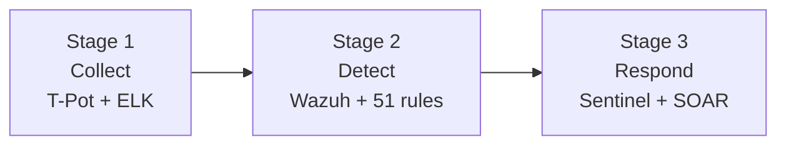
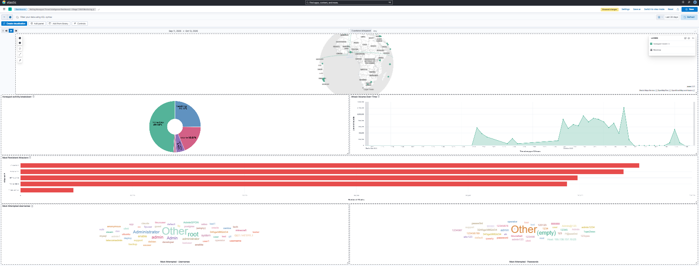
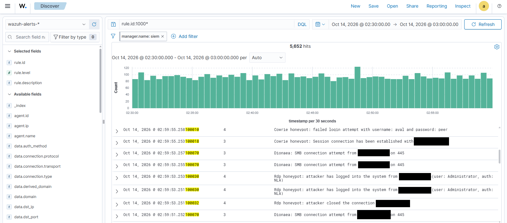
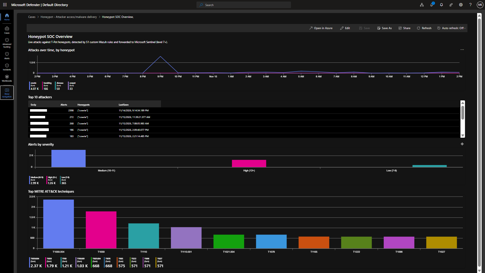

# End-to-End Threat Intelligence: Honeypot to SOC

**T-Pot · Elastic Stack · Wazuh · Microsoft Sentinel · KQL · Logic Apps · Azure · Python · MITRE ATT&CK**

I put a honeypot on the internet, let real attackers hit it, and built everything a small SOC needs around it, one stage at a time. It started as a way to see raw attack traffic. It ended as a working pipeline that collects the logs, detects the attacks with rules I wrote myself, opens incidents, looks up the attacker and alerts my phone.

Each stage builds on the one before it, and each has its own folder with the full write-up, configs and screenshots.

## At a glance

| | |
|---|---|
| **18.8 million** | attack events collected in the first two weeks (Stage 1) |
| **51** | custom Wazuh detection rules, each mapped to MITRE ATT&CK and seen firing (Stage 2) |
| **~230** | Sentinel incidents in the first four days of the analytics rules (Stage 3) |
| **~98%** | fewer alerts from the noisiest rule after tuning, with every attacker still reported (Stage 3) |
| **Seconds** | from a new incident to an AbuseIPDB lookup and a Slack and Telegram alert (Stage 3) |

## How it grew



## The three stages

### [Stage 1: Honeypot and Elastic Stack](stage1-honeypot-elk/README.md)

**Question:** what does the internet actually throw at an exposed server?

I ran T-Pot on a Vultr VM and shipped every honeypot log over a private network to my own Logstash, Elasticsearch and Kibana server. The result was a live dashboard showing where attacks come from, which services get hit, and which usernames and passwords bots try most.

**Tools:** T-Pot, Filebeat, Logstash, Elasticsearch, Kibana, Vultr



### [Stage 2: Detection engineering with Wazuh](stage2-wazuh-detection/README.md)

**Question:** Kibana shows the data, but what tells me an attack is happening?

I stood up a Wazuh SIEM, added a real Windows Server as RDP bait, and wrote 51 detection rules by hand from real attacker log lines. They cover SSH logins, brute force, malware downloads, fake industrial control systems and post-login activity on Windows, all mapped to MITRE ATT&CK.

**Tools:** Wazuh 4.14, Sysmon, Windows Server 2022, MITRE ATT&CK (Enterprise and ICS), Vultr



### [Stage 3: Microsoft Sentinel and automated response](stage3-sentinel/README.md)

**Question:** how do I get from an alert to an investigated incident without sitting at a dashboard?

I rebuilt the lab on Azure and wrote a Python integration that streams serious Wazuh alerts into Microsoft Sentinel. Two KQL analytics rules turn them into incidents, and a Logic Apps playbook looks up each attacker on AbuseIPDB, writes the result into the incident and sends an alert to Slack and Telegram.

**Tools:** Microsoft Azure, Microsoft Sentinel, KQL, Logic Apps, Azure Monitor Logs Ingestion API, Entra ID, Python, AbuseIPDB



## Skills this project covers

- **Log pipelines:** shipping, parsing and enriching logs (Filebeat, Logstash, GeoIP), index templates and field mappings
- **Detection engineering:** writing and testing SIEM rules, correlation rules, severity models, MITRE ATT&CK mapping
- **Cloud security:** Azure VNets and NSGs, least-privilege Entra ID apps, managed identities, secrets kept out of source control
- **SIEM and SOAR:** Microsoft Sentinel, KQL analytics rules, entity mapping, workbooks, Logic Apps playbooks
- **Alert tuning:** finding the noisy rules, cutting volume without losing coverage
- **Troubleshooting:** every stage README has a section on what broke and how I fixed it

## Repository map

```
End-to-End-Threat-Intelligence/
├── README.md                    You are here
├── stage1-honeypot-elk/         T-Pot, ELK pipeline, Kibana dashboard
├── stage2-wazuh-detection/      Wazuh rules, decoders, agent configs
└── stage3-sentinel/             Sentinel integration, KQL rules, playbook, workbook
```

## A note on safety

The honeypots were built to be attacked, so they were kept apart from everything else. Analysis servers were never exposed to the internet, and the Windows bait host was moved off the private network before RDP was opened. Real IPs of my own, credentials, API keys and subscription details are left out of this repo. Attacker IPs that appear in the write-ups are defanged, like `195.178.110[.]78`.

## Credits

- [T-Pot CE](https://github.com/telekom-security/tpotce) by Telekom Security
- [Wazuh](https://wazuh.com)
- [AbuseIPDB](https://www.abuseipdb.com) for IP reputation
- Vultr (Stages 1 and 2) and Microsoft Azure (Stage 3) for hosting

## About me

I'm **Mohammed Aadil Khan**, a former network engineer moving into security operations. I hold the CCNA and CompTIA Security+, and I built this project to learn the SOC workflow by doing it end to end.

[LinkedIn](https://www.linkedin.com/in/aadil-khan-cybersecurity)
