# End-to-End Threat Intel Project

I set up a honeypot on a cloud VM, let the internet attack it, and built a pipeline that turns the raw logs into a live Kibana dashboard. I'm building this in stages and adding each one to this same repo, so the history of how it grew stays in one place.

Stage 1 is finished and documented below.

## Roadmap

| Stage | What it adds | Status |
|-------|--------------|--------|
| 1 | Honeypot VM, Elastic Stack data server, Kibana dashboard | Done |
| 2 | [Stage 2: Detection Engineering with Wazuh]A detection layer built on top of the same logs | Done |
| 3 | Automated alerting and response | Coming soon |

---

## Stage 1: Honeypot + Elastic Stack

### The setup

Two Vultr VMs sit in the same private network.

- **Honeypot VM** runs [T-Pot](https://github.com/telekom-security/tpotce), which is a Docker Compose stack of honeypots and network sensors. Almost the whole port range is open to the internet on purpose. Only management SSH and the T-Pot web UI are restricted to my own IP.
- **Data server VM** runs Logstash, Elasticsearch and Kibana. It has no public exposure at all.


### How an event travels

Every honeypot container writes its own JSON log. Filebeat on the honeypot VM tails those files and ships each new line across the private network to Logstash. Filebeat does no parsing. I wanted the box that gets attacked to run as little logic as possible.

Logstash does the real work. A JSON filter breaks the raw line into fields, a GeoIP filter adds country, city and coordinates for the attacker's IP, and a date filter normalizes the timestamp. The result goes into Elasticsearch as a daily index named `honeypot-YYYY.MM.DD`.

Kibana is only reachable through an SSH tunnel via the honeypot VM, so nothing about the data server is visible from outside.

### The dashboard

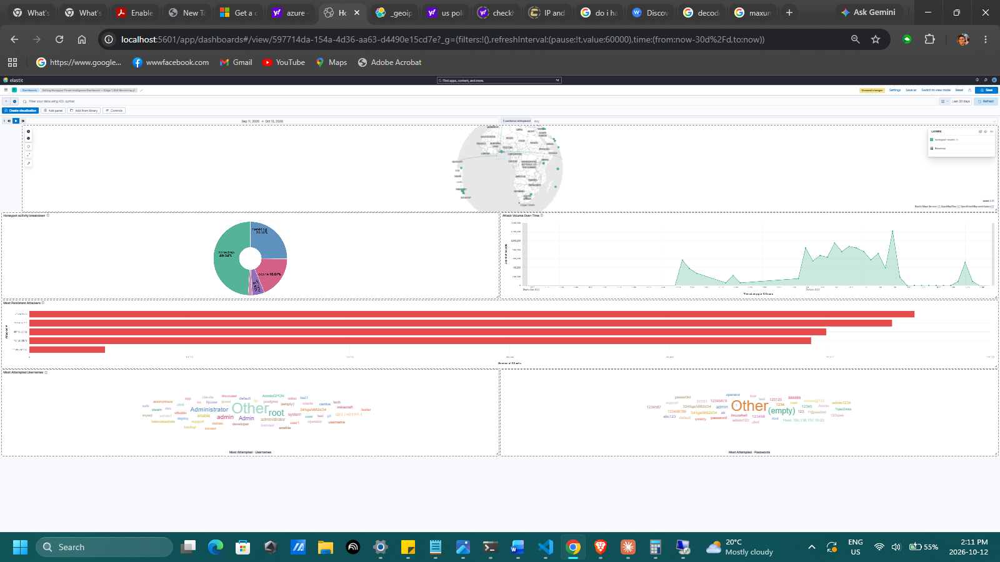

| Panel | What it shows |
|-------|---------------|
| Honeypot Activity Breakdown | Share of all logged events per sensor, including the passive tools (p0f, Suricata) |
| Interactive Honeypot Breakdown | Same idea with the passive tools filtered out, so only real attacker interaction is left |
| Attacker Origins Map | Where attacking IPs are located, plotted from the GeoIP coordinates |
| Attack Volume Over Time | Events per time bucket, which makes bursts and quiet stretches easy to spot |
| Top Attacking IP Addresses | The most persistent source IPs, ranked by event count |
| Most Attempted Credentials | A tag cloud of the usernames and passwords bots try most often |

The dashboard also has controls for the time range and for filtering to a single honeypot, so one sensor's activity can be isolated across every panel at once.

A closer look at the main panels:

**Where the attacks come from**

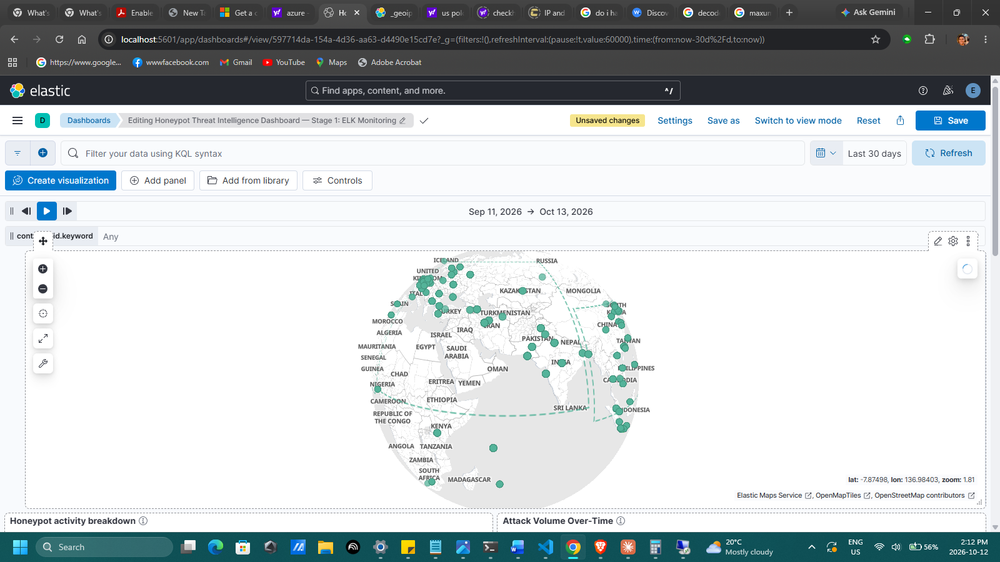

**Which sensors see the traffic**


**When it happens**


**Who keeps coming back**


### What the data showed

Snapshot from [date range]:

- Across all sensors, p0f accounted for about 67% of events and Suricata about 23%. That's expected. Both watch every packet that touches the box, while the interactive honeypots only log when something connects to their fake service.
- Once those two were filtered out, Honeytrap led with about 44%, Heralding had about 32%, and Cowrie had about 18%. My guess is that Honeytrap leads because it listens on ports that no other sensor claims, and Heralding's share reflects how many bots probe FTP, POP3 and similar protocols for weak logins. I haven't verified either explanation, so treat them as readings of the data rather than conclusions.


### Problems I ran into

**Events silently disappearing for two days.** Elasticsearch was rejecting events because the timestamps didn't match the format Logstash handed over, and nothing in the pipeline complained. Every stage looked healthy while nothing reached storage. I fixed it by making the date filter match the format each container actually emits. The lesson I took from it: check the data at the end of the pipeline, not just whether each service is running.

**Field names that weren't what I assumed.** I first wrote my filters expecting nested fields like `session.id`. The containers emit flat names like `session_id`. A Logstash filter pointed at a field that doesn't exist just skips it without an error, so the only symptom was missing enrichment. I had to compare my config against real raw events, container by container.

**A map with no dots.** Kibana Maps refused to plot the GeoIP data. The mapping check showed why: Elasticsearch had typed `lat` and `lon` as two separate `float` fields instead of one `geo_point`. The relevant part of my Logstash config is:

```
if [attacker][ip] {
  geoip {
    source => "[attacker][ip]"
    target => "[attacker][geoip]"
  }
}
```

The geoip filter already outputs the right shape. Elasticsearch just wasn't told to treat it as a point, so it guessed. A field's type can't be changed once an index exists, so the fix was an index template that applies to every new `honeypot-*` index:

```json
{
  "index_patterns": ["honeypot-*"],
  "priority": 200,
  "template": {
    "mappings": {
      "properties": {
        "attacker": { "properties": { "geoip": { "properties": { "geo": { "properties": {
          "location": { "type": "geo_point" }
        } } } } } }
      }
    }
  }
}
```

I created the next day's index early so I could confirm the mapping showed `geo_point` before any data landed in it. Older indices keep the old mapping, so historical data would need a reindex to show up on the map.

### A note on keeping the lab contained

The honeypot is expected to get compromised eventually, so the design assumes it will. The analysis box only accepts traffic from the private network, Filebeat is the single link between the two, and Kibana is never exposed. Real IPs, ports and credentials are deliberately left out of this repo.

### What I learned

Most of what I took away from this stage came from things breaking, not from things working.

- A pipeline can look healthy and deliver nothing. During the timestamp problem every service was running, and the only way I caught it was looking at what had actually landed in Elasticsearch.
- Check a real raw event before writing a filter. Guessing field names cost me a full rework.
- Logstash and Elasticsearch both fail quietly. A filter skips an event when its field is missing, and an event with an unparseable timestamp just gets dropped. Neither one raises its hand.
- Field types get decided when an index is created. Declaring them in a template up front is much cheaper than fixing them afterwards, and a fix only helps new data.

Reading the numbers matters as much as collecting them. p0f making up two thirds of all events looked odd until I remembered it logs every packet that touches the box. The more useful picture only showed up once I filtered it out and looked at the sensors that attackers actually interact with.

I also ran into least privilege in a small way. Kibana refuses to connect as the `elastic` superuser and wants a scoped service account token instead, which made me think harder about which component actually needs which level of access.

On the design side, keeping the exposed machine as simple as possible paid off. Filebeat only ships logs and everything that thinks happens on the private box, so when something broke there was far less to untangle.

---

## Stage 2: 

# Stage 2: Detection Engineering with Wazuh

**Part 2 of 3 of the T-Pot/Vultr Honeypot Threat Intel Project.**
This is the second part of my honeypot project. In Stage 1 I put a T-Pot honeypot on the internet and shipped everything it caught into my own ELK stack. About 18.8 million events landed in the first two weeks.

Kibana is great for looking at that data. It doesn't alert on anything, though, and it has no idea what an attack actually looks like. So for Stage 2 I stood up a Wazuh SIEM, pointed the honeypot at it, added a real Windows server as bait, and wrote the detection rules myself.

Where it ended up:

51 custom rules: 41 for the T-Pot honeypots, 10 for the Windows box
Rules for Cowrie, Heralding, RDPHoneyPot, ConPot (three fake ICS devices), Dionaea, and Windows event logs plus Sysmon
Every alerting rule mapped to MITRE ATT&CK, including the ICS matrix for ConPot
Every rule seen firing, either on real attack traffic or on a test I ran myself


## Architecture

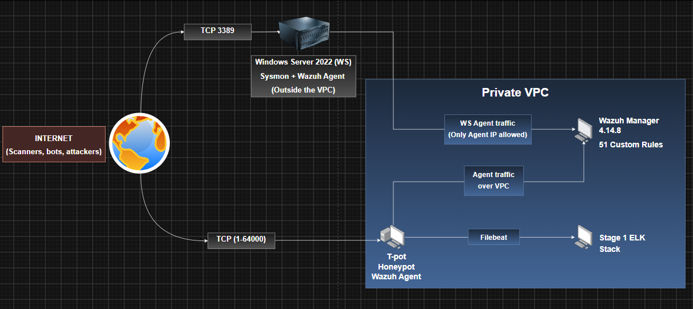

**Why the two agents reach the manager differently**

The Wazuh manager has its own Vultr instance in the same private network as T-Pot. I didn't want it fighting the ELK stack for memory on the same box.

The Windows host is the odd one out. It started inside the VPC, but I pulled it out before opening RDP to the internet. That machine runs a real OS and is supposed to get broken into, and I didn't want it sitting on the same private network as my SIEM. It talks to the manager over the internet now. Ports 1514/1515 only accept its IP, both in the Vultr firewall and in UFW on the manager.

**Hardening on the SIEM itself**

- **Wazuh API.** Moved off `0.0.0.0:55000` and bound to `127.0.0.1` only.
- **UFW on the manager.** Allows SSH, agent ports 1514/1515, and the VPC subnet, nothing else.
- **Both firewall layers.** Every port is opened in the Vultr group and in UFW. Opening one is never enough.

## Wazuh setup: Manager and T-Pot agent

**Manager**
- Wazuh 4.14.8 on a dedicated Ubuntu instance in the same Vultr VPC as T-Pot. It stays off the ELK box so the two stacks don't fight over memory.
- Custom decoder in `decoders/local_decoder.xml`.
- Rules in `/var/ossec/etc/rules/`, one file per honeypot.

**T-Pot agent**
- Installed natively on the honeypot host, enrolled over the VPC.
- The agent does not discover log files by itself. T-Pot's installer only registered its own system monitors, so every honeypot log has a `<localfile>` block.
- Each container reports its log path from inside Docker. The agent needs the host path that T-Pot mounts under `~/tpotce/data/<honeypot>/log/`.

**Windows RDP bait host**
- A real Windows Server 2022 instance exposed on RDP. It complements the emulated RDP service in T-Pot: this one runs the actual OS, so post-login behaviour (new accounts, services, LOLBins) produces genuine Windows events.
- T-Pot already has a fake RDP service, but fake services only show you the login. I wanted to see what someone does after they get in, so I set up a real Windows Server 2022 box on Vultr and left RDP open.
- A low-privilege account called `support`, only in the Remote Desktop Users group. It has a weak-looking password that still passes the 14-character policy. Nobody should ever log into it, so any attempt is an attacker.
- Account lockout left at "Never". If brute force locked the account, the logs would stop.
- The built-in Administrator renamed and given a strong password, so attackers have to guess the username too.
- Audit policy for process creation with full command lines (4688), logons, service installs, and Defender and firewall changes. Sysmon on top, with the SwiftOnSecurity config.
- Wazuh agent 4.14.8, matching the manager.
- Windows Firewall and the Vultr group both allow 3389. Verified with `nmap -Pn` (host drops ICMP) going from `filtered` to `open`.
  
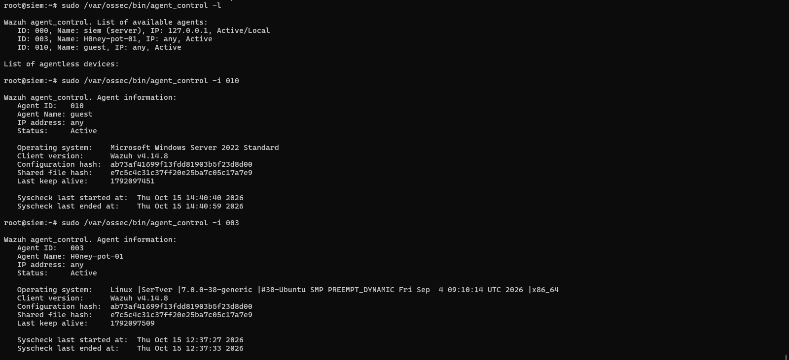
*Both agents reporting in, each on Wazuh 4.14.8 to match the manager.*

**How I validated rules**

To test a rule, I'd paste a real log line into wazuh-logtest on the manager.
1. `wazuh-logtest` on the manager with a real captured log line.
   - Phase 2 shows what the decoder extracted.
   - Phase 3 shows which rule won.
2. Live traffic: either a controlled action (SSH into Cowrie, connect to a port) or waiting for organic attacks.
3. Alerts checked in `/var/ossec/logs/alerts/alerts.json` and on the dashboard.


`wazuh-logtest` treats every line as a fresh event, so a "5 failures in 2 minutes" rule can only be proven against the live pipeline.

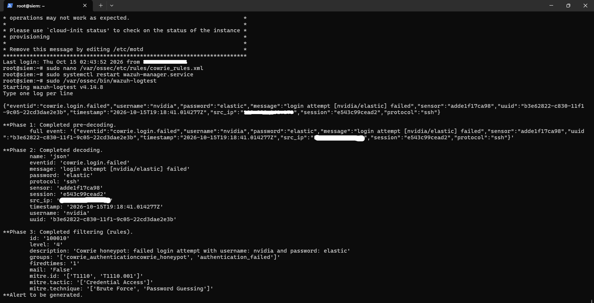
*A real failed login run through `wazuh-logtest`. 
Phase 2 is what the decoder extracted, 
Phase 3 is my rule 100010 matching with its ATT&CK tags.*

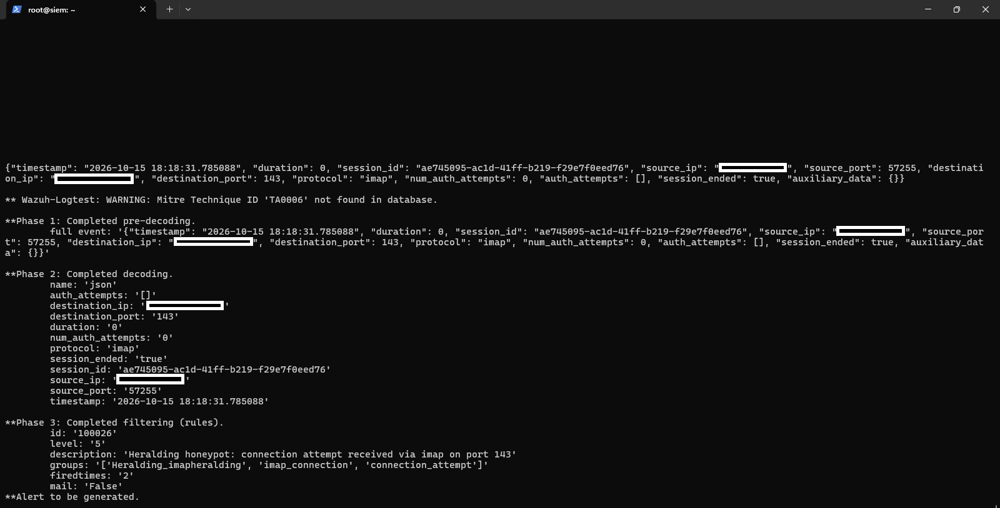
*A real Heralding log through 'wazuh-logtest'.*

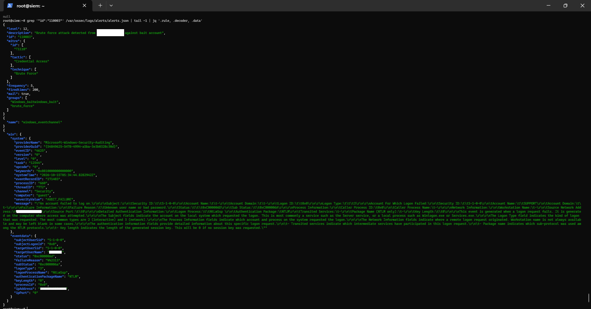
*A real Windows log through 'wazuh-logtest'.*


## Rule inventory

Full XML with per-rule notes is in [`rules/`](rules). Levels are Wazuh severity (0-15).
On a honeypot, everything that shows up is hostile, so "is this bad?" isn't a useful question. I set levels by how far the attacker got instead. Connections and scans sit low (0-5). Credential attempts and real protocol commands land in the middle (6-10). Brute force patterns, successful logins, payload downloads and anything touching admin rights or Defender go high (10-14).
A couple of patterns show up across the files. One rule records every event of a type, and a second one escalates when something specific shows up (all commands vs. dangerous commands). A single-event rule usually has a correlation rule sitting on top of it to catch the burst (one failed login vs. five in two minutes).

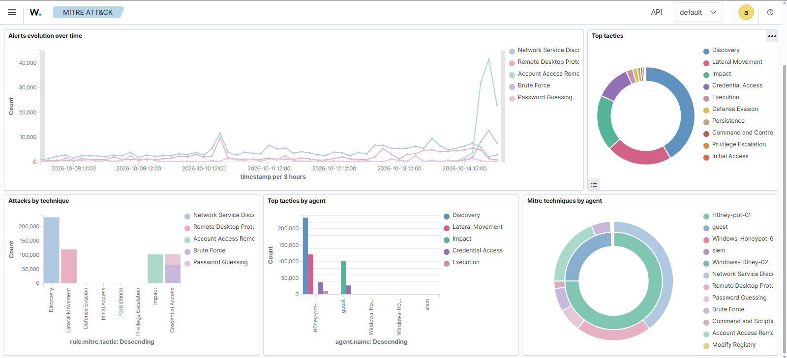


### Cowrie, SSH/Telnet (`01_cowrie_rules.xml`, 10 rules)

| ID | Level | Detects | ATT&CK |
|---|---|---|---|
| 100010 | 4 | Failed login | T1110, T1110.001 |
| 100011 | 10 | Brute force: 5 failures in 120s from one IP | T1110, T1110.001 |
| 100012 | 12 | Successful login, attacker has a shell | T1078, T1021.004 |
| 100013 | 10 | Any command typed (full session record) | T1059, T1059.004 |
| 100014 | 12 | Dangerous command: wget, curl, chmod, base64, nc, busybox, /bin/sh, passwd... | T1105, T1222, T1027, T1059.004, T1098 |
| 100015 | 3 | Session closed | n/a |
| 100016 | 14 | File downloaded inside the shell | T1105 |
| 100017 | 3 | Unrecognised command (often honeypot fingerprinting) | T1059, T1059.004 |
| 100018 | 3 | New connection | T1046 |
| 100019 | 0 | Protocol telemetry (version banner, kex, params). Tagged, never alerts | deliberately unmapped |

### Heralding, multi-protocol credential capture (`02_heralding_rules.xml`, 9 rules)

| ID | Level | Detects | ATT&CK |
|---|---|---|---|
| 100021 | 8 | VNC session (5900) | T1110, T1021.005 |
| 100022 | 7 | SMTPS session (465) | T1110 |
| 100023 | 6 | POP3 session (110) | T1110 |
| 100024 | 5 | PostgreSQL session (5432) | T1110 |
| 100025 | 5 | SOCKS5 session (1080) | T1110 |
| 100026 | 5 | IMAP session (143) | T1110 |
| 100027 | 5 | IMAPS session (993) | T1110 |
| 100028 | 5 | POP3S session (995) | T1110 |
| 100029 | 10 | 5+ sessions in 30s from one IP, any service | T1110 |

Per-service levels follow a priority call: VNC first (live desktop control), then mail relay abuse, then mailbox and database access.

### RDPHoneyPot, emulated RDP (`03_rdp_honeypot_rules.xml`, 3 rules)

| ID | Level | Detects | ATT&CK |
|---|---|---|---|
| 100030 | 4 | Credentials submitted (NLA) | T1110, T1021.001 |
| 100031 | 5 | Connection opened | T1046 |
| 100032 | 4 | Connection closed | T1046 |


### ConPot, ICS/SCADA (`04_conpot_rules.xml`, 11 rules)

| ID | Level | Device | Detects | ATT&CK (ICS) |
|---|---|---|---|---|
| 100040 | 3 | Guardian AST fuel tank gauge | New connection | T0846 |
| 100041 | 3 | Guardian AST | Connection lost | T0846 |
| 100042 | 7 | Guardian AST | Real protocol command (e.g. I20100 tank inventory) | T0801 |
| 100050 | 7 | IEC 60870-5-104 grid telecontrol | New connection | T0846 |
| 100051 | 7 | IEC 104 | Connection lost | T0846 |
| 100060 | 3 | Kamstrup 382 meter, management | New connection | T0846 |
| 100061 | 3 | Kamstrup management | Connection lost | T0846 |
| 100062 | 8 | Kamstrup management | Data/command sent | T0888 |
| 100063 | 3 | Kamstrup meter protocol | New connection | T0846 |
| 100064 | 3 | Kamstrup meter protocol | Connection lost | T0846 |
| 100065 | 8 | Kamstrup meter protocol | Data/command sent | T0888 |

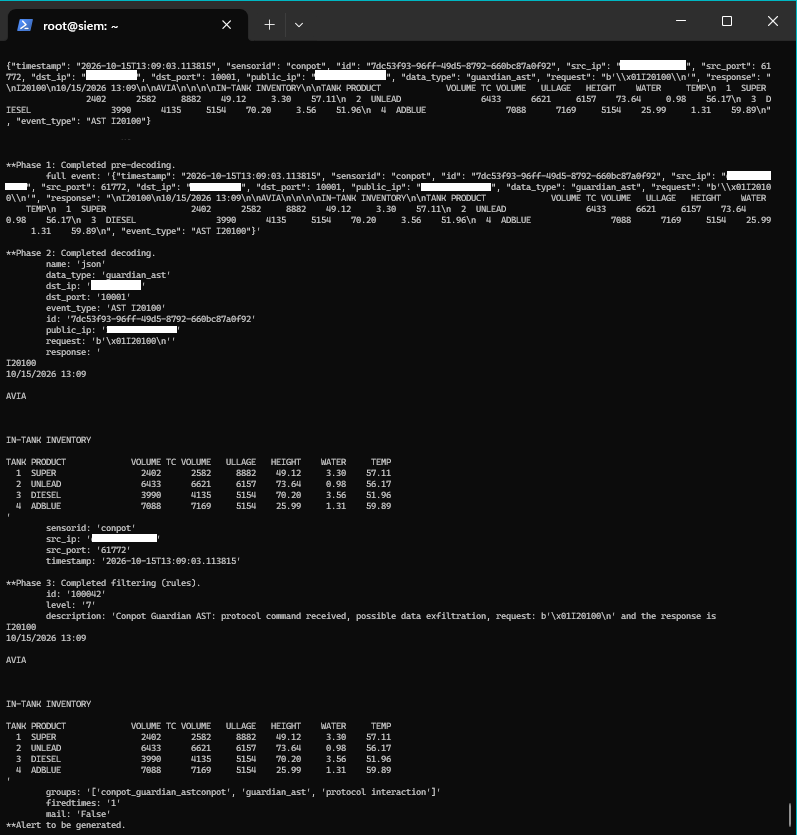

*A real I20100 command sent to the fake fuel tank gauge, and the fake tank inventory it sent back, matched by 100042.*


### Dionaea, malware capture (`05_dionaea_rules.xml`, 8 rules)

| ID | Level | Detects | ATT&CK |
|---|---|---|---|
| 100070 | 3 | SMB connection | T1046 |
| 100071 | 3 | Database connection (MSSQL, MySQL, MongoDB) | T1046 |
| 100072 | 3 | FTP connection | T1046 |
| 100073 | 3 | Any other emulated service | T1046 |
| 100074 | 7 | Credentials submitted, any service | T1110 |
| 100077 | 13 | Credential brute force: 5 in 120s from one IP | T1110, T1110.001 |
| 100075 | 10 | FTP command activity | T1595 |
| 100076 | 12 | Non-FTP data on the FTP port (scanners, raw TLS, HTTP probes) | T1595.002 |


### Windows bait host (`06_windows_bait_rules.xml`, 10 rules)

| Rule | Detects | How I triggered it | ATT&CK |
|---|---|---|---|
| 110001 | Logon attempt on bait account | RDP as `support` with a wrong password | T1110 |
| 110002 | Successful RDP logon (type 10) | Interactive RDP session | T1021.001, T1078 |
| 110003 | Brute force on bait account | Repeated failed `support` logons from one IP | T1110 |
| 110004 | New local user | `net user hacker <password> /add` | T1136.001 |
| 110005 | User added to privileged group | `net localgroup Administrators hacker /add` | T1098, T1078.003 |
| 110006 | New service installed | `sc.exe create testservice binPath= "cmd.exe"` | T1543.003 |
| 110007 | LOLBin download | `certutil -urlcache -split -f http://example.com/test.txt C:\temp\test.txt` | T1105, T1218 |
| 110008 | Recon commands | `whoami`, `systeminfo`, `net user` | T1033, T1082, T1016 |
| 110009 | Defender real-time protection off | `Set-MpPreference -DisableRealtimeMonitoring $true` | T1562.001 |
| 110010 | Firewall rule change | `netsh advfirewall firewall add rule name="test" dir=in action=allow protocol=tcp localport=4444` | T1562.004 |

In PowerShell, `sc` is an alias for `Set-Content`, so the service test has to call `sc.exe`.

It didn't take long for the real thing to show up. Within a day of opening RDP, bots were hammering the `support` account:

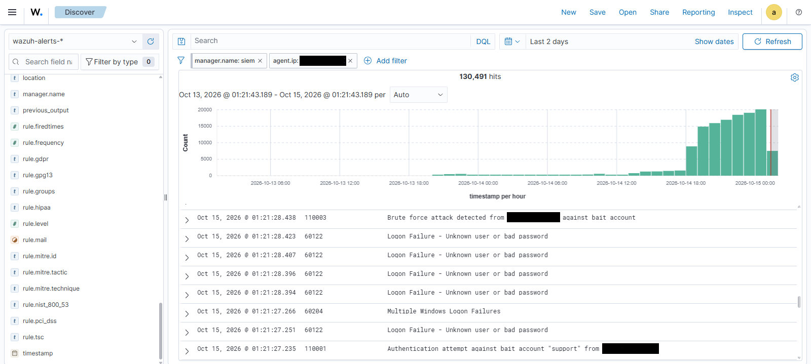 
*Over 130,000 alerts from the bait host in two days. Wazuh's built-in rules log each failed logon, and my 110001 and 110003 flag the ones aimed at the bait account.*

---

## Problems I ran into

The parts of this stage I learned the most from. Each one is written as what I saw, what was actually wrong, and the fix.


### Wazuh pipeline

**1. Agent would not enroll.**
- **What I saw:** The honeypot kept failing to reach the manager on port 1515. tcpdump on the manager showed the SYN arriving with no reply.
- **What was wrong:** I'd added the firewall rule for the agent ports on the honeypot instead of the manager.
- **Fix:** Moving it to the right box fixed it instantly. Since then, I always check which side of the connection a rule actually lives on.

**2. Rule could never fire.**
- **What was wrong:** I'd based it on one of Wazuh's built-in login-failure rules. That rule is written for old syslog-style logs, and Cowrie sends JSON, so my rule had no way in no matter what else it checked.
- **Fix:** match `decoded_as json` plus the decoded `eventid` directly, the same pattern Wazuh's own Suricata rules use.

**3. Brute force rule silently dead.**
- **What was wrong:** I'd used `<same_source_ip/>`, which sounds right. It actually compares a built-in field called `srcip`, and Cowrie calls its field `src_ip`.
- **Fix:** Switching to `<same_field>src_ip</same_field>` fixed it.

**4. Reserved field names.**
- **What I saw:** Heralding records the service in a field called `protocol`, and that's one of 13 names Wazuh reserves.
- **What I tried:**
  - I tried renaming it with a decoder, which wiped out every other field. 
- Then I tried Wazuh's special tag for it, which hit a separate bug.
- **Fix:** In the end I matched on the destination port, since each Heralding service listens on a fixed port anyway. Dionaea has the same field, but nested as `connection.protocol`, and that name isn't reserved.

**5. A correct rule kept losing.**
- **What I saw:** My ConPot rules decoded perfectly in testing, but a built-in rule at level 0 won every time, phase 3 always picked built-in 86600 (level 0).
- **What I ruled out:** I ruled out broken XML (`xmllint`), duplicate IDs and load errors before trying `<if_sid>86600</if_sid>` to hang my rules off that built-in one.
- **Fix:** `<if_sid>86600</if_sid>`. 86600 acts as the root rule for that JSON path. It is not needed everywhere: Dionaea's rules fire without it, so I test standalone first.

**6. JSON null is not empty.**
- **What I saw:** A rule meant to catch commands sent to the Kamstrup meter fired on every plain connection.
- **What was wrong:** Wazuh turns a JSON `null` into the text "null", which counts as "has a value", which satisfies `.+`.
- **Fix:** The fix was to match anything that isn't exactly `null` so `negate="yes"` on `^null$`.

**7. Arrays become strings.**
- **What I saw:** Dionaea's `ftp.commands.command` and Heralding's `auth_attempts` are JSON arrays, but the decoder flattens them into one string like `['USER', 'PASS']`. That killed my first approach of checking each command against an allow-list.
- **What failed:** an anchored allow-list can never match a multi-command session.
- **Fix:**  The rule now looks for the normal FTP words anywhere in that string and now uses pcre2 word boundaries.
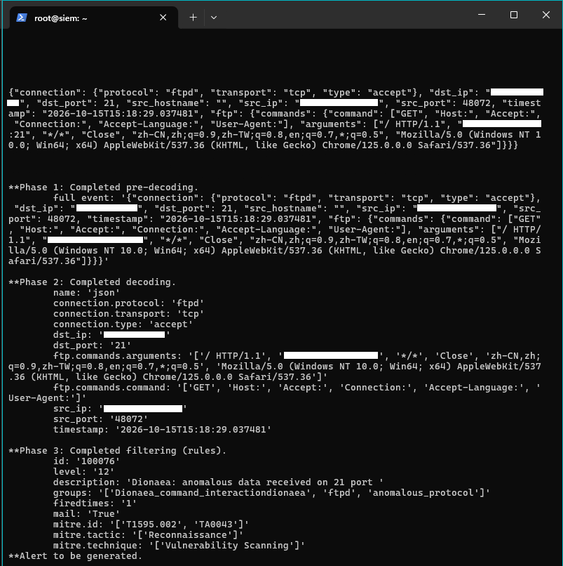
*A scanner sending an HTTP request to the FTP port. Note how ftp.commands.command arrives as one flattened string. Rule 100076 catches it.*

**8. Rule dependencies can create blind spots.**
- **What was wrong:** I'd made the FTP command rule depend on the credential rule. That meant any session that sent commands without logging in was invisible, including a real scanner probe I'd already captured.
- **Fix:** the two signals are independent, so the rules are too.

**9. Unscoped matches leak across sources.**
- **What I saw:** a Heralding rule matching the raw text `"protocol":` also fired on Dionaea SMB logs.
- **Fix:** every rule is scoped to something only its own source writes.

### Windows bait host

**10. No way to download tools.**
- **What I saw:** The server couldn't resolve DNS, and the Wazuh installer kept arriving cut off at 5.66 MB instead of about 34 MB.
- **Fix:** I staged Sysmon, its config and the MSI over RDP drive and clipboard redirection, checking file size before running anything.

**11. The new Windows agent hijacked the honeypot's identity.**
- **What I saw:** While enrolling the Windows box, I imported a key that belonged to the existing T-Pot agent. You could tell from the dashboard: that ID showed Ubuntu 26.04 and the honeypot's VPC address.
- **What was wrong:** the ID belonged to the T-Pot agent, so two hosts were fighting over one identity.
- **Fix:** registered the Windows host as its own agent. A Wazuh key belongs to exactly one agent.

**12. Re-registration after the network change.**
- **What I saw:** A `Duplicate agent name`, because the old entry still existed.
- **Fix:** I removed it with `manage_agents -r` and re-ran `agent-auth.exe` against the manager's public address.
- `manage_agents` handles keys. `agent_control -i` is the one that shows status.

**13. Locking down the API.**
- **What I saw:** Binding the Wazuh API to localhost took three tries. `ss -tlnp` showed the Wazuh API on `0.0.0.0:55000`.
- **What failed:** a plain string in `api.yaml` crashed the manager, and `['127.0.0.1', '::']` left IPv6 open.
- **Fix:** Changed to `host: ['127.0.0.1']`, a YAML list with one entry.

## Repository layout and deployment

```
stage2-wazuh-detection/
├── README.md
├── rules/
│   ├── 01_cowrie_rules.xml
│   ├── 02_heralding_rules.xml
│   ├── 03_rdp_honeypot_rules.xml
│   ├── 04_conpot_rules.xml
│   ├── 05_dionaea_rules.xml
│   └── 06_windows_bait_rules.xml
├── decoders/
│   └── local_decoder.xml
├── config/
│   ├── tpot-agent-localfiles.xml
│   ├── windows-agent-sysmon.xml
│   └── manager-api.yaml
└── docs/
    └── CLEANUP_NOTES.md
```


## Stage 3: Coming soon


## Credits

* T-Pot CE by Telekom Security.
* Vultr VPS for hosting.
---

## Author

Mohammed Aadil Khan
